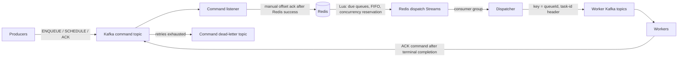
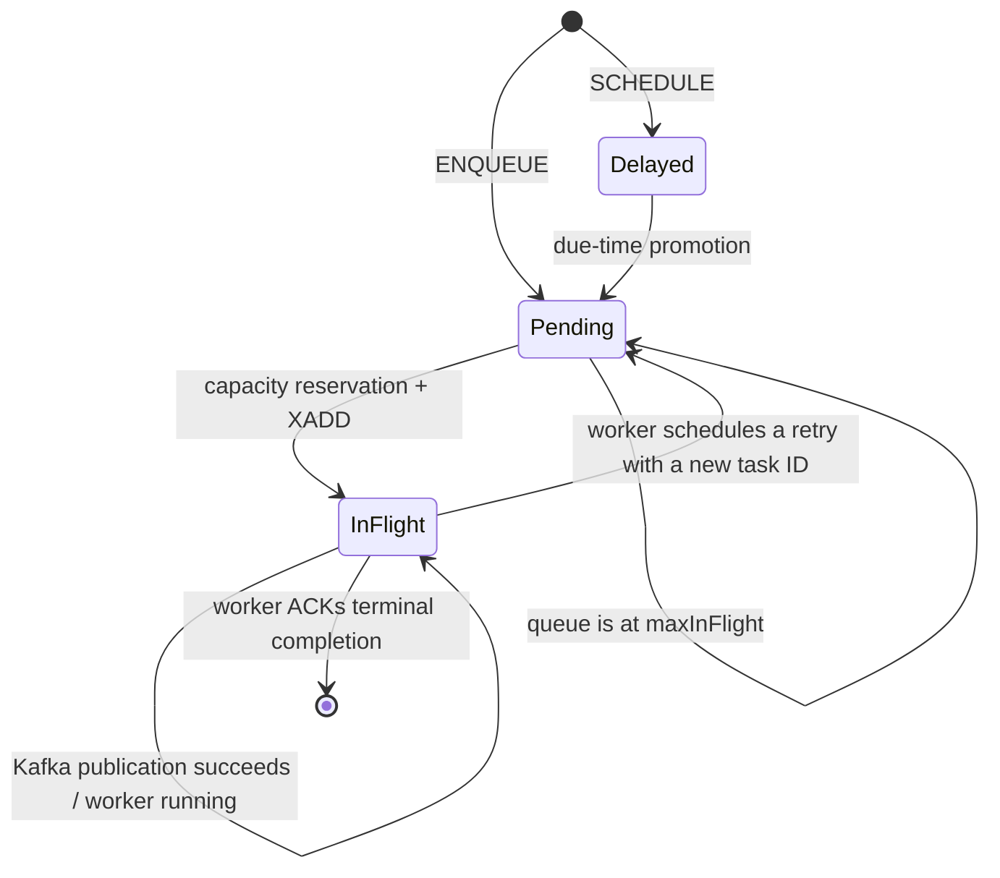

# Architecture and Operations

## Runtime flow

## Redis state transitions

Each queue is assigned to a stable shard derived from its ID. Queue-specific state, the shard's active-queue sorted set, and its dispatch stream use the same Redis Cluster hash tag. Lua scripts serialize transitions within that slot.

| Key suffix | Type | Lifecycle |
|---|---|---|
| `:q:<encoded-id>:pending` | List | Retained while queued tasks exist |
| `:q:<encoded-id>:inflight` | Hash | Retained until each task is ACKed |
| `:q:<encoded-id>:delayed` | Sorted set | Retained until delayed work is promoted |
| `:q:<encoded-id>:limit` | String | Retained for the lifetime of the active queue |
| `:q:<encoded-id>:topic` | String | Fixed Kafka destination for the active queue |
| `:q:<encoded-id>:tasks` | Set | Active task IDs across pending, delayed, and in-flight work |
| `:q:<encoded-id>:dedupe:<task-id>` | String | Expires after the configured deduplication TTL |
| `:active` | Sorted set | Bounded to active queue IDs per shard |
| `:dispatch` | Stream | Entries are deleted after Kafka confirmation |
| `:dispatch-lock` | String | Short-lived per-shard dispatch lease |

`maxInFlight` counts tasks reserved for delivery or currently executing. A slot is released only by an `ACK`. Redis Streams retain dispatch entries in a consumer group's pending-entry list until Kafka confirms publication and the entry is acknowledged/deleted in Redis.

## Delivery and recovery guarantees

- Kafka command offsets are acknowledged only after command validation and its Redis mutation complete. Redelivery after a crash is deduplicated by task ID for the configured TTL.
- Redis script execution is atomic per shard; Redis Cluster cross-slot operations are avoided.
- Dispatch uses a Redis Stream consumer group and a token-checked per-shard lease so only one replica publishes that shard at a time. A replica reclaims entries idle longer than `dispatch-claim-idle`.
- The Kafka send is awaited before its Redis Stream entry is deleted. A crash between those operations can publish a duplicate, so workers must deduplicate using the `scheduler-task-id` header.
- No distributed transaction spans Kafka and Redis. Delivery is at least once, not exactly once.
- A worker must ACK after success or terminal failure. A retry is a new task with a new ID and an explicit due time.

## Scaling and partitioning

Run multiple identical service instances in one Kafka command consumer group and one Redis dispatch consumer group. Kafka partitions distribute command processing; Redis Streams distribute dispatch. Use a unique `SCHEDULER_CONSUMER_ID` per instance. Producers should key commands by `queueId`. Per-shard dispatch leases preserve stream order across replicas; Kafka record keys on output are `queueId`, preserving order for a queue's fixed topic.

Queue IDs map to one configured Redis shard. `SCHEDULER_SHARD_COUNT` and `SCHEDULER_KEY_PREFIX` must remain stable while state exists. Shards distribute keys across Redis Cluster slots; hot queue IDs remain serialized and are constrained by their own in-flight limit.

## Health and telemetry

- `/actuator/health/liveness`: process liveness.
- `/actuator/health/readiness`: dependency-aware readiness.
- `/actuator/prometheus`: counters for commands, promotions, acknowledgements, and dispatch outcomes.
- Console logs use structured JSON. Trace and span fields are populated when tracing instrumentation provides them. Never log task payloads.

Keep metric labels bounded; queue IDs and task IDs are not metric labels.

## Production checklist

- Configure TLS and ACL credentials for Redis and authenticated TLS for Kafka through environment or platform secret injection.
- Set Redis persistence/replication, `noeviction`, memory limits, and alerting. Never expire live queue or stream data.
- Provision command, dead-letter, and worker topics with appropriate partitions, replication, and retention before rollout.
- Use unique stable queue/task IDs and idempotent workers.
- Alert on dead-letter growth, Redis memory pressure, consumer lag, pending stream entries, promotion failures, and missing worker acknowledgements.
- Set `SCHEDULER_DISPATCH_CLAIM_IDLE` longer than the maximum normal Kafka send duration, avoiding unnecessary concurrent retries.
- Drain queues before changing namespace, shard count, command schema incompatibly, or Redis deployment topology.

## Failure behavior

| Failure | Behavior |
|---|---|
| Invalid JSON or invalid command fields | Kafka retries; after configured attempts, the record is published to `<command-topic>.DLT`. |
| Redis unavailable while handling a command | Listener does not acknowledge the record; Kafka retries. |
| Kafka unavailable during dispatch | Redis Stream entry remains pending and can be reclaimed; the queue slot remains reserved. |
| Service stops after Kafka accepts a task but before Redis dispatch acknowledgement | Task may be published again; worker deduplication is required. |
| Worker never sends ACK | Queue capacity remains occupied; operational alert and explicit terminal recovery are required. |
| Redis state loss | Recovery depends on Redis persistence/replication; durable business state must be held outside this service. |
